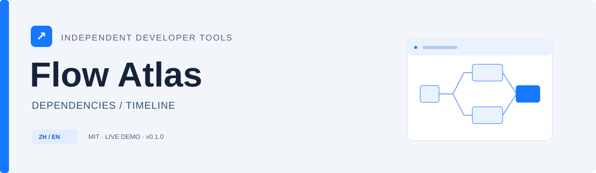

[](https://github.com/chenpingan-dev/flow-atlas/actions/workflows/ci.yml)  

# Flow Atlas

An interactive map of dependencies, critical paths and worker schedules.

用依赖图和时间轴，理解任务排期、关键路径与并行执行。

**[Open workflow planner](https://chenpingan-dev.github.io/flow-atlas/)** · **[中文说明](README.zh-CN.md)** · [Contributing](CONTRIBUTING.md) · [Changelog](CHANGELOG.md)


## What it does

| Capability                 | Behavior                                                                               |
| -------------------------- | -------------------------------------------------------------------------------------- |
| **Dependency map**         | A layered DAG layout with selectable tasks and highlighted critical edges.             |
| **Critical-path analysis** | Compute earliest start, finish and slack using forward and backward passes.            |
| **Worker simulation**      | Compare bounded parallelism, makespan and utilization on a per-worker timeline.        |
| **Editing and playback**   | Add, edit and remove tasks, scrub or play the schedule, and import / export workflows. |
| **Bilingual examples**     | Three synthetic workflows and a Chinese / English UI with remembered preferences.      |

## Run locally

Requires **Node.js 22+**. No external packages are required to run the app.

```bash
git clone https://github.com/chenpingan-dev/flow-atlas.git
cd flow-atlas
npm ci
npm start
```

Open **http://127.0.0.1:4173**. Use `PORT=4174 npm start` on macOS/Linux or `$env:PORT=4174; npm start` in PowerShell to choose another port. ES modules require a local HTTP server; opening `index.html` directly is not supported.

Use the **English / 中文** button in the upper-right corner. Chinese is the initial language; a browser preference is saved locally. User-entered data and task IDs are preserved when the language changes.

## Try this

The preview-deployment example takes **32 seconds with one worker** and **20 seconds with three workers**. Add a dependency from `checkout` to `preview` to observe cycle rejection; the last valid graph remains available.

## How it works

`src/graph.js` validates the input, produces a topological order, calculates critical-path metrics and assigns tasks using deterministic list scheduling. The priority is longest remaining dependency path, then task ID. `app.js` draws SVG edges and HTML nodes and runs the playback clock.

```text
src/       Core logic and locale support
test/      Node.js regression tests
examples/  Synthetic data or runnable usage examples
assets/    Original SVG artwork and actual app screenshot
scripts/   Local server and static-site builder
```

## Verification

```bash
npm test
npm run build
```

The test suite contains **12 tests**. GitHub Actions runs tests and builds on Windows and Ubuntu with Node.js 22 and 24. Browser checks cover the main interactions, language switching and layout at 390 px width. `npm run build` writes a static site to `dist/`; the demo workflow deploys it to GitHub Pages.

## Deliberate limits

This is a planning simulator, not a job executor. It supports up to 100 tasks, 1–16 workers in the core API, and positive durations up to 3,600 seconds. Tasks are non-preemptive and workers are interchangeable. List scheduling is a heuristic and **does not guarantee an optimal makespan**. Critical-path duration is a dependency lower bound. Removing a task also removes references to it from other tasks. Layout scrolls for large graphs; there is no drag editor, server or saved graph history.

## Project scope

An independent personal project created with AI-assisted development. Source code and example data were created for this repository; examples are synthetic. This is a small working release intended to be read, run and extended.

## License

[MIT](LICENSE)
