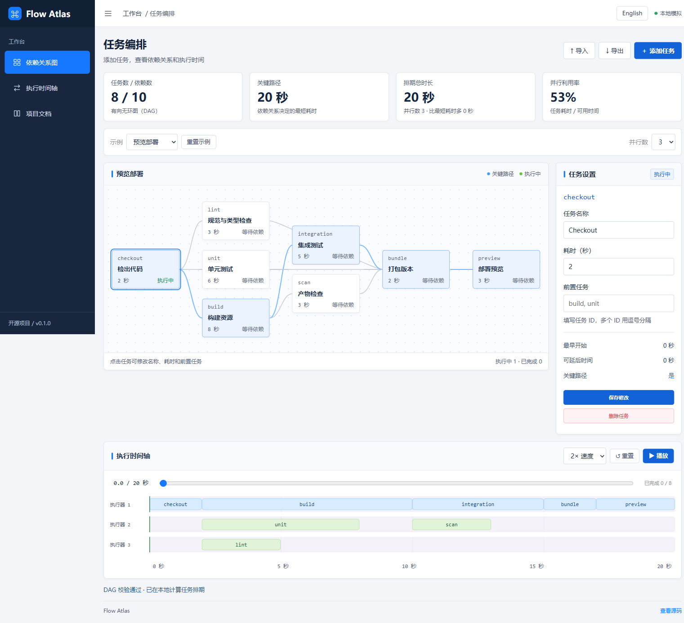

# Flow Atlas

用依赖图和时间轴，理解任务排期、关键路径与并行执行。

[在线演示](https://honggege957-collab.github.io/flow-atlas/) · [English](README.md)



## 功能

- 依赖可视化：自动分层布局，点击节点查看详情，突出显示关键路径。
- 排期分析：计算最早开始、最早结束、可延迟时长与依赖理论下限。
- 并发模拟：按工作线程绘制时间轴，比较总时长和利用率。
- 任务编辑：添加、修改、删除任务，校验未知依赖和循环依赖，支持 JSON 导入导出。
- 双语页面：中英文切换；附带预览部署、数据流水线、并行构建三个示例。

## 快速开始

需要 Node.js 22 或以上，无需外部运行时依赖。

```bash
git clone https://github.com/honggege957-collab/flow-atlas.git
cd flow-atlas
npm ci
npm start
```

浏览器访问 `http://127.0.0.1:4173`。请通过 HTTP 服务器运行，不要直接双击 HTML 文件。页面右上角可以切换中英文，默认中文，选择会在本地保存。数据字段、任务 ID 等原始内容不随语言改变。

## 试一试

默认预览部署示例使用 1 个工作线程时需要 32 秒，3 个线程时需要 20 秒。尝试让 `checkout` 依赖 `preview`，会收到循环依赖提示，原来的有效图不会被替换。

## 验证与部署

```bash
npm test
npm run build
```

包含 12 项测试，CI 在 Windows、Ubuntu 和 Node.js 22、24 上执行。浏览器验证覆盖主要交互、中英切换和 390 像素宽度的布局。构建产物位于 `dist/`，仓库附带 GitHub Pages 自动部署配置。

## 边界

这是规划模拟器，不执行真实任务。最多支持 100 个任务，核心 API 支持 1–16 个工作线程，任务时长大于 0 且不超过 3600 秒。线程能力一致，任务不能抢占。列表调度是启发式算法，不保证最优排期；关键路径时长是依赖关系的理论下限。删除任务时也会移除对它的依赖。未实现拖拽编辑、服务端执行或图历史保存。

## 关于

这是新建的个人项目，使用 AI 辅助开发。代码和示例数据为此项目创建，示例均为虚构数据。项目定位是可以运行、阅读和继续扩展的小型开源工具。

MIT 开源协议，见 [LICENSE](LICENSE)。
